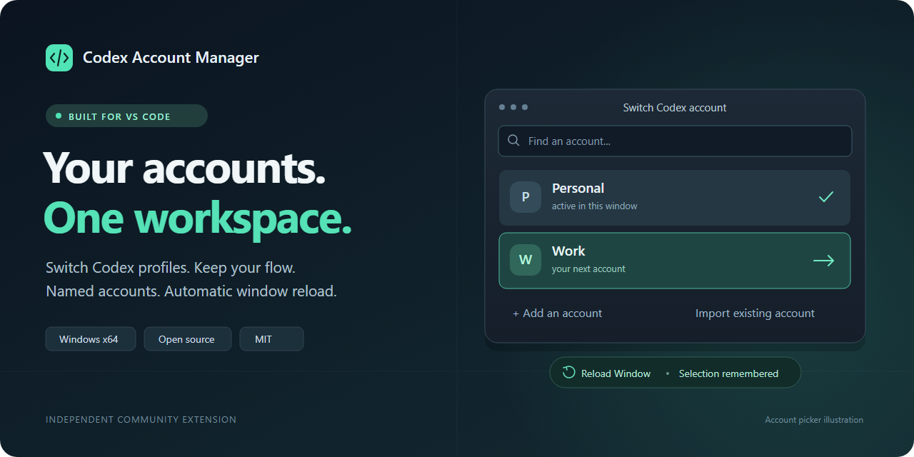

# Codex Account Manager for VS Code

**Switch between multiple OpenAI Codex accounts without leaving Visual Studio Code.**
Name your profiles, keep credentials separate, and change accounts with an automatic
window reload. Built for Windows x64.

**[Download for Windows](https://github.com/tuncismail/codex-account-manager/releases/latest)**
&ensp;·&ensp; [Quick start](#quick-start)
&ensp;·&ensp; [Türkçe](docs/README.tr.md)
&ensp;·&ensp; [Report a bug](https://github.com/tuncismail/codex-account-manager/issues/new)

An independent, MIT-licensed community extension. Not affiliated with OpenAI.

## Multiple accounts, one familiar workflow

| Feature | What you get |
| --- | --- |
| **Switch from the status bar** | Select an account and reload the current window automatically. |
| **Name accounts your way** | Use Personal, Work, or any label; rename without moving files. |
| **Bring existing accounts** | Import a Codex folder or create a new one and sign in. |
| **Keep credentials separate** | Each account uses its own CODEX_HOME directory. |
| **Choose how to handle history** | Separate histories by default; optional local transcript sharing. |
| **Stay in control** | Inspect diagnostics or disconnect and restore your previous CLI setting. |

The picker also has buttons to rename an account, sign in, open its folder, or
remove its saved entry. Your last selection is remembered across reloads.
There is no synthetic "Default" account: import an existing folder and name it.

## Quick start

1. Install the [official OpenAI Codex extension](https://marketplace.visualstudio.com/items?itemName=openai.chatgpt)
   in desktop VS Code on Windows.
2. Open the [latest release](https://github.com/tuncismail/codex-account-manager/releases/latest)
   and download the Windows x64 **.vsix** file.
3. In VS Code, run **Extensions: Install from VSIX...** and select the downloaded file.
4. Click **Codex: Select account** in the status bar. Add a new account or import
   your existing Codex account directory.
5. Choose **Sign In** for a new account and complete device authorization in the
   terminal. Then select that account to switch.

Selecting an account runs **Reload Window**. Installing the manager alone does
not change your CLI setting or reload the editor. Renaming changes only the
display name; removing an entry retains its files and credentials.

> **Before uninstalling:** run **Codex Accounts: Disconnect Account Manager** to
> restore the original Codex CLI setting. [Disconnect instructions](#disconnect-or-uninstall).

## Requirements

| Requirement | Purpose |
| --- | --- |
| Windows x64 and desktop VS Code 1.96.2+ | Supported extension host |
| Official OpenAI Codex extension, installed locally | Supplies Codex and sign-in |
| .NET Framework 4.8 | Runs the Windows launcher included in the VSIX |
| Node.js 22+ and npm | Only needed to build from source |

End users do not need a global npm package or a separate Codex CLI installation.
macOS, Linux, Windows ARM64, WSL mode, remote windows, and VS Code for the Web
are not supported by this release.

## Frequently asked questions

### How do I switch Codex accounts in VS Code?

Click the Codex account name in the status bar and select another saved account.
The extension reloads the current window and starts Codex with that account's
directory. You can also run **Codex Accounts: Switch Account** from the Command Palette.

### Can I reuse my existing Codex login?

Yes. Choose **Import an existing account...**, select the directory containing
your existing Codex profile, and give it a name. Credentials stay in that folder.

### Does switching accounts close VS Code?

The manager uses VS Code's **Reload Window** command. It does not quit the
application. Integration tests verify that the main process and unsaved text
survive account switches.

### What happens with multiple VS Code windows?

Selection is shared by local windows. A window already running another account
keeps its process until reloaded. Its status bar indicates that a reload is needed;
select the desired account in that window.

### Is this an official OpenAI extension?

No. This is a community account manager that works alongside the official Codex
extension. Its CLI integration may need updates when Codex changes.

## Commands

| Command | Action |
| --- | --- |
| Codex Accounts: Switch Account | Choose an account; row buttons provide quick actions |
| Codex Accounts: Add Account | Create and name a profile directory |
| Codex Accounts: Import Existing Account | Register an existing directory |
| Codex Accounts: Rename Account | Change the display name |
| Codex Accounts: Sign In to Account | Start the bundled Codex device authorization flow |
| Codex Accounts: Remove Account | Remove the entry without deleting files |
| Codex Accounts: Open Account Folder | Open the directory in Explorer |
| Codex Accounts: Show Diagnostics | Show a report suitable for a bug report |
| Codex Accounts: Disconnect Account Manager | Restore the previous CLI setting and reload |

## Settings and history

Account paths are machine settings. Workspace settings cannot redirect the manager.

| Setting | Default | Meaning |
| --- | --- | --- |
| codexAccountManager.profiles | Empty list | Names and absolute directories |
| codexAccountManager.activeProfileHome | Empty | Last selection; managed automatically |
| codexAccountManager.shareSessionHistory | false | Link transcripts and the session index |
| codexAccountManager.showStatusBar | true | Show the selector |
| codexAccountManager.statusBarPriority | 100 | Position; reload after changing |

History sharing requires account folders on the same volume. It uses directory
junctions and a hard link to the normal Codex home's session index. Original
histories are backed up before linking; nested directories are merged and
conflicting files stop the operation without deleting originals. Credentials and
other settings are not linked.

Turning sharing off stops creating links; it does not separate already-linked
histories. Disconnecting also retains links and backups. Avoid editing the same
conversation from several accounts at once. Existing 0.4 installations retain
their previous sharing behavior when upgraded.

## Disconnect or uninstall

Run **Codex Accounts: Disconnect Account Manager** before disabling or uninstalling.
This restores the previous custom CLI setting (or removes the manager's override)
and reloads. Saved accounts and their files remain available.

If you already uninstalled it, reset **Chatgpt: Cli Executable** in User Settings
or restore your previous value, then run **Developer: Reload Window**.
Disconnecting does not sign out of Codex or alter an existing system CODEX_HOME
environment variable. Select an account again to reconnect.

## How it works

The launcher is compiled from [launcher.cs](src/launcher.cs). It starts the actual
Codex executable from the installed official extension with the selected
CODEX_HOME, forwarding arguments, stdin, stdout, stderr, and exit status. A Windows
job object ends the child when the launcher exits. Switching invokes the VS Code
reload command without quitting the application.

The manager discovers Codex through VS Code's extension API. No personal directory
or installed Codex version is embedded in source. Launcher configuration and
executables live in VS Code's extension global storage.

The integration uses **chatgpt.cliExecutable**, which the official Codex extension
labels as a development setting. Future changes to that setting or the CLI layout
may require a compatibility update. See the
[extension manifest reference](https://code.visualstudio.com/api/references/extension-manifest)
and [packaging documentation](https://code.visualstudio.com/api/working-with-extensions/publishing-extension)
for VS Code host and platform packaging conventions.

The manager does not read, copy, export, or upload credentials. Codex handles
authentication. The manager adds no telemetry. Its local launch log contains
timestamps, process IDs, and account paths, bounded to approximately 1 MiB.
Use Diagnostics for bug reports instead of sharing this raw log.

## Build and test

On Windows, from a clean checkout:

~~~powershell
npm ci
npm run build
npm run check
npm test
npm run test:launcher
npm run audit:source
npm audit
npm run package
~~~

The result is codex-account-manager-win32-x64-0.5.0.vsix. Packaging recompiles the launcher.
Generated executables and VSIX files are excluded from Git; the launcher is
included in the VSIX.

There are **zero runtime npm dependencies**. Packaging uses a pinned development
dependency and lockfile. A scoped minimatch override fixes GHSA-g3hv-75wg-m249
in the packaging tool's dependency tree.

Unit and native tests use temporary fixtures and require no login.
To test actual window reloads with the installed Codex extension:

~~~powershell
npm run test:vscode
~~~

This opens a separate window with disposable signed-out profiles. It checks
selection, unsaved text, process lifetime, and disconnect, without switching
your real accounts. Standard installations are detected automatically; custom
locations can use CAM_VSCODE_EXE and CAM_CODEX_EXTENSION. Temporary reports
are retained for inspection.

CI runs unit tests on Windows and Linux, builds and tests the Windows launcher,
audits dependencies, and produces a Windows VSIX artifact. It does not publish
an extension or create a release.

Runtime code is in **src/**, build tools are in **scripts/**, and regression
tests are in **test/**. Keep credentials, account folders, and personal machine
paths out of contributions. The source audit is a heuristic; review your diff too.

The cover is an illustration using fictional labels. Edit **assets/banner.svg**
and run **scripts/render-banner.ps1** to render its PNG with Chrome or Edge.
The image is already included; a browser is not needed to build the extension.

## Bugs and security

For bugs, include the output of **Codex Accounts: Show Diagnostics** in an
[issue](https://github.com/tuncismail/codex-account-manager/issues/new).
Do not attach credentials, transcripts, or raw launch logs.
Report vulnerabilities through
[private vulnerability reporting](https://github.com/tuncismail/codex-account-manager/security/advisories/new).

## License

[MIT](LICENSE).
