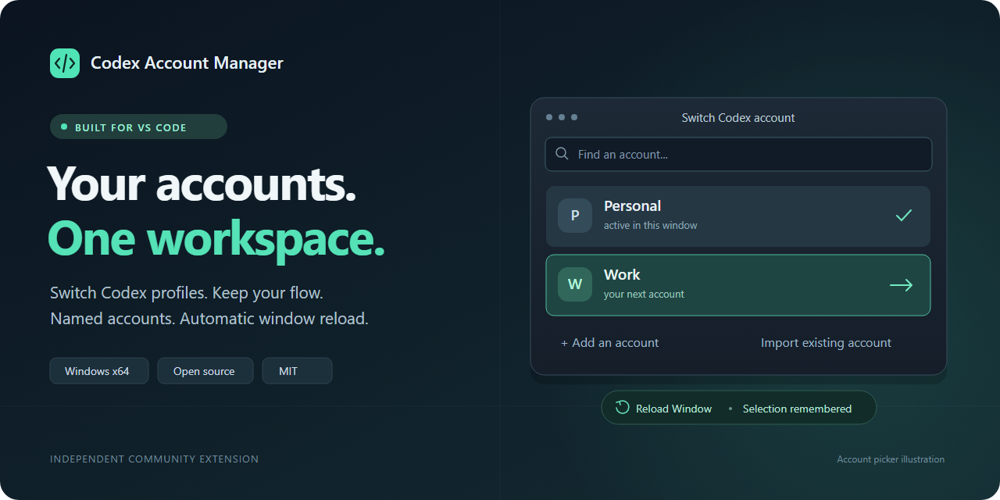

# Codex Account Manager: VS Code için hesap değiştirme

**Visual Studio Code içinde birden fazla OpenAI Codex hesabını yönetin.**
Hesaplarınıza isim verin, giriş bilgilerini ayrı tutun ve durum çubuğundan
hesap değiştirin. Seçim yaptığınızda pencere otomatik yenilenir.

[English](../README.md) · **[Windows sürümünü indir](https://github.com/tuncismail/codex-account-manager/releases/latest)**
· [Hata bildir](https://github.com/tuncismail/codex-account-manager/issues/new)

Bağımsız, MIT lisanslı bir topluluk eklentisidir. OpenAI'nin resmi ürünü değildir.

## Neler yapabilirsiniz?

| Özellik | Kullanım |
| --- | --- |
| Hesap değiştirme | Durum çubuğundan seçin; VS Code otomatik Reload Window çalıştırsın. |
| İsimlendirme | Hesabı yeniden adlandırın; klasörün konumu değişmesin. |
| Mevcut hesabı ekleme | Kullandığınız Codex klasörünü içe aktarın. |
| Yeni hesapla giriş | Ayrı klasörde cihaz yetkilendirmesiyle oturum açın. |
| Ayrı giriş bilgileri | Her hesabın kendi CODEX_HOME klasörü olsun. |
| İsteğe bağlı geçmiş paylaşımı | Konuşmaları ayrı tutun veya yerel geçmiş paylaşımını açın. |
| Bağlantıyı geri alma | Önceki Codex CLI ayarını tek komutla geri yükleyin. |

Son seçilen hesap hatırlanır. Listede yapay bir Default hesabı bulunmaz.
Hesap satırındaki düğmelerle yeniden adlandırabilir, giriş yapabilir, klasörü
açabilir veya kaydı listeden kaldırabilirsiniz. Listeden kaldırma dosyaları silmez.

## Kurulum

1. Windows üzerinde masaüstü VS Code'a
   [resmi OpenAI Codex eklentisini](https://marketplace.visualstudio.com/items?itemName=openai.chatgpt) kurun.
2. [Son sürüm sayfasından](https://github.com/tuncismail/codex-account-manager/releases/latest)
   Windows x64 için **.vsix** dosyasını indirin.
3. Komut paletinden **Extensions: Install from VSIX...** komutunu çalıştırıp dosyayı seçin.
4. Durum çubuğundaki **Codex: Select account** düğmesine tıklayın.
5. **Add an account...** ile yeni hesap oluşturun veya **Import an existing account...**
   ile mevcut Codex klasörünüzü ekleyin.
6. Yeni hesapta **Sign In** seçeneğiyle giriş yapın. Ardından hesap listesinden
   kullanmak istediğiniz hesabı seçin.

Eklenti yalnızca kurulunca Codex ayarınızı değiştirmez; bir hesap seçtiğinizde
devreye girer. Hesap değişiminde uygulamayı kapatmak yerine mevcut pencereyi yeniler.

## Gereksinimler

- Windows x64 ve VS Code 1.96.2 veya üzeri.
- Yerel olarak kurulu resmi Codex eklentisi.
- .NET Framework 4.8.
- Kaynaktan derlemek isterseniz Node.js 22+ ve npm.

Hazır VSIX'i kullanmak için ayrı bir Codex CLI veya global npm paketi gerekmez.
Bu sürüm macOS, Linux, Windows ARM64, WSL, uzak pencereler ve tarayıcıdaki VS Code'u
desteklemez. Eklentinin arayüzü İngilizcedir.

## Geçmiş ve gizlilik

Yeni kurulumlarda hesap geçmişleri ayrıdır. İsterseniz
**codexAccountManager.shareSessionHistory** ayarını açabilirsiniz.
Paylaşım için klasörlerin aynı disk bölümünde olması gerekir. İlk birleştirmede
eski geçmiş yedeklenir; giriş bilgileri paylaşılmaz.

Paylaşımı sonradan kapatmak mevcut bağlantıları ayırmaz. Aynı konuşmaya farklı
hesaplardan eşzamanlı yazmayın. 0.4 sürümünden yükseltenlerin mevcut paylaşım
davranışı korunur.

Hata bildirirken **Codex Accounts: Show Diagnostics** çıktısını kullanın.
Bu rapor hesap adlarını, kişisel yolları ve giriş bilgilerini içermez.

## Kaldırmadan önce

**Codex Accounts: Disconnect Account Manager** komutunu çalıştırın.
Önceki Codex CLI ayarı geri yüklenir ve pencere yenilenir. Hesap dosyaları korunur.

Eklentiyi zaten kaldırdıysanız kullanıcı ayarlarındaki **Chatgpt: Cli Executable**
değerini sıfırlayın veya önceki özel değerinizi geri koyun; ardından
**Developer: Reload Window** çalıştırın.

## Geliştirme

Derleme, testler ve katkı bilgileri için [İngilizce README](../README.md#build-and-test),
sürüm notları için [Releases](https://github.com/tuncismail/codex-account-manager/releases)
sayfasına bakın. Çalışma kodu **src/**, derleme araçları **scripts/**,
testler **test/** klasöründedir.

[MIT lisansı](../LICENSE).
